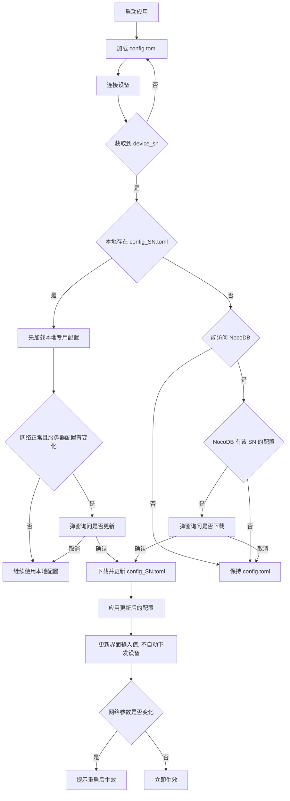

# 无人机采集卡上位机

基于 **Tauri v2 + Rust + Vue** 构建的跨平台桌面应用，通过 UDP/TCP 与 FPGA 采集卡通信。

## 功能

- **设备发现**：通过 UDP 广播自动搜索局域网内的采集卡设备
- **系统状态监控**：实时查询和显示采集卡系统状态（温度、电机、ADC、GPS、存储等）
- **激光器控制**：开关、内/外触发、重频、电流与实时状态查询（0x0200/0x0201 透传）
- **电机控制**：初始化、速度模式、绝对定位与回零（0x0f00 透传 EPOS2）
- **设备电源**：远程重启（约 25 秒）与关机（约 15 秒），弹窗确认并显示倒计时
- **实时数据折线图**：Canvas 自绘高性能折线图（100Hz / 4000 数据点）
- **设备控制**：激光器、采集参数、电机、存储等控制功能
- **SSD / SD 卡文件**：SSD 通过 TCP 下载；SD 卡 GPS 文件通过 SFTP 列出并下载

## 开发

### 环境要求

- Node.js >= 18
- Rust >= 1.70
- Linux: `libwebkit2gtk-4.1-dev` `libgtk-3-dev` 等系统依赖

### 开发命令

```bash
# 安装依赖
npm install

# 开发模式（热更新）
npm run tauri dev

# 构建生产版本
npm run tauri build

# 仅类型检查
npx vue-tsc --noEmit

# Rust 测试
cd src-tauri && cargo test
```

## 配置文件

| 文件 | 说明 |
|---|---|
| `config.toml` | 默认完整配置，与可执行文件同目录；首次运行不存在时自动生成 |
| `config_<SN>.toml` | 设备专用配置，保存完整配置，例如 `config_SN_260601ALCN.toml` |

启动时固定加载 `config.toml`；连接设备并获取 `device_sn` 后，按以下逻辑决定是否切换到设备专用配置：



- 加载或下载配置后只更新界面输入值，不会自动下发到设备。
- `[basic]` 中本机 IP / 端口变化时，需要重启应用后生效。

## 项目结构

```
app/
├── package.json              # 前端依赖
├── vite.config.ts            # Vite 配置
├── tsconfig.json             # TypeScript 配置
├── config.toml               # 应用配置
├── index.html                # 入口 HTML
├── src/                      # Vue 前端源码
│   ├── main.ts               # 入口
│   ├── App.vue               # 根组件
│   ├── style.css             # 全局样式
│   ├── types/                # TypeScript 类型定义
│   ├── components/           # Vue 组件
│   │   ├── Layout.vue        # 主布局（三栏）
│   │   ├── ControlPanel.vue  # 左侧控制面板
│   │   ├── ChartView.vue     # Canvas 折线图
│   │   ├── StatusPanel.vue   # 右侧状态面板
│   │   └── DeviceSelector.vue # 设备选择弹窗
│   └── composables/          # Vue Composables
│       ├── useDeviceDiscovery.ts
│       ├── useSystemStatus.ts
│       └── useChart.ts
└── src-tauri/                # Rust 后端
    ├── Cargo.toml
    ├── tauri.conf.json
    └── src/
        ├── main.rs
        ├── lib.rs
        ├── config.rs         # 配置加载
        ├── protocol.rs       # 协议帧编解码
        ├── network.rs        # UDP 网络通信
        ├── commands.rs       # Tauri 命令
        └── status.rs         # 系统状态解析
```

## 通信协议

采用定长帧格式：2字节帧头 `0x1234` + 14字节元数据 + 可变数据区 + 2字节保留 + 2字节帧尾 `0xCDEF`。

详见 `doc/src/protocol_format.md`。
